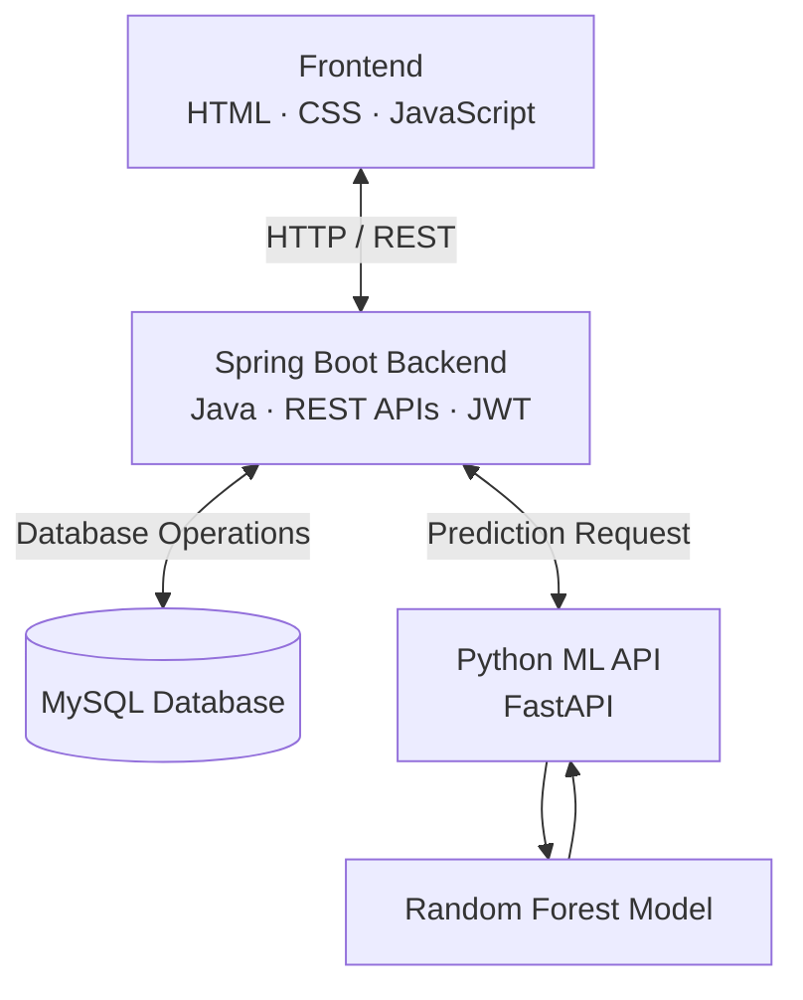

<h1 align="center">
  
  <strong>Vitalis AI</strong>
</h1>

<h3 align="center">Intelligent Disease Prediction System</h3>

<p align="center">
  A machine-learning-powered platform for symptom-based disease prediction.
</p>

<p align="center">
  
  
  
  
  
</p>

---

## 📌 Overview

**Vitalis AI** is a web-based disease prediction system that analyzes user-selected symptoms using a trained machine learning model.

It integrates a responsive frontend, Java Spring Boot backend, Python-based ML API, and MySQL database to provide an end-to-end prediction experience.

## ✨ Features

| Feature | Description |
|:---|:---|
| 🔐 Authentication | User registration and login |
| 👤 Patient Profile | Personal and health-related information |
| 🩺 Symptom Analysis | Multiple symptom selection |
| 🤖 AI Prediction | Random Forest-based disease prediction |
| 📊 Confidence Score | Prediction confidence percentage |
| 📜 Prediction History | Access previous predictions |
| ⚙️ REST API | Frontend, backend and ML integration |

## 🏗️ System Architecture



## 🛠️ Tech Stack

| Layer | Technologies |
|:---|:---|
| Frontend | HTML5, CSS3, JavaScript |
| Backend | Java, Spring Boot |
| Machine Learning | Python, Scikit-learn |
| ML API | FastAPI, Uvicorn |
| Database | MySQL |
| Authentication | Spring Security, JWT |
| Build Tool | Maven |
| Version Control | Git, GitHub |

## 📂 Project Structure

```text
Vitalis-AI/
│
├── index.html
├── login.html
├── dashboard.html
├── patient.html
├── symptoms.html
├── result.html
├── history.html
├── profile.html
│
├── auth.css
├── auth.js
├── dashboard.css
├── dashboard.js
├── patient.css
├── patient.js
├── symptoms.css
├── symptoms.js
├── result.css
├── result.js
├── history.css
├── history.js
├── profile.css
├── profile.js
├── style.css
├── script.js
│
├── backend/
│   └── vitalis-backend/
│       ├── src/
│       │   ├── main/
│       │   │   ├── java/
│       │   │   │   └── com/vitalis_backend/
│       │   │   │       ├── config/
│       │   │   │       ├── controller/
│       │   │   │       ├── dto/
│       │   │   │       ├── entity/
│       │   │   │       ├── repository/
│       │   │   │       ├── security/
│       │   │   │       └── service/
│       │   │   └── resources/
│       │   └── test/
│       └── pom.xml
│
├── vitalis-ml/
│   ├── app.py
│   ├── requirements.txt
│   ├── model_features.pkl
│   ├── model_features.txt
│   └── prediction utilities
│
└── .gitignore
```

## 🚀 Getting Started

### Prerequisites

- Java JDK
- Python 3.x
- MySQL Server
- Git
- VS Code or any preferred IDE

### 1. Clone Repository

```bash
git clone https://github.com/ayushtripathi-45/Vitalis-AI.git
cd Vitalis-AI
```

### 2. Database Setup

Create the database in MySQL:

```sql
CREATE DATABASE vitalis_db;
```

Configure the backend environment variables:

```env
DB_URL=jdbc:mysql://localhost:3306/vitalis_db
DB_USERNAME=root
DB_PASSWORD=your_mysql_password
PORT=8080
ML_API_URL=http://127.0.0.1:8000
```

### 3. Start the ML Service

```powershell
cd vitalis-ml

python -m venv venv
venv\Scripts\activate

pip install -r requirements.txt
```

Place the trained `random_forest.pkl` model inside the `vitalis-ml/` directory.

Start the API:

```bash
uvicorn app:app --host 127.0.0.1 --port 8000
```

API documentation: `http://127.0.0.1:8000/docs`

### 4. Start the Backend

Open another terminal:

```powershell
cd backend/vitalis-backend

.\mvnw.cmd spring-boot:run
```

Backend URL: `http://localhost:8080`

### 5. Start the Frontend

Open the project root in VS Code and launch `index.html` using the Live Server extension.

Ensure the frontend API configuration points to the running backend.

## 🔌 ML API Reference

| Method | Endpoint | Description |
|:---:|:---|:---|
| GET | `/` | API status |
| GET | `/health` | Service health check |
| GET | `/features` | Retrieve model features |
| POST | `/predict` | Generate prediction |

**Sample Request**

```json
{
  "features": {
    "feature_name": 1
  }
}
```

**Sample Response**

```json
{
  "predicted_disease": "Example Disease",
  "confidence": 92.45
}
```

Actual input features must match the trained model's expected feature names and format.

## ⚙️ Environment Variables

| Variable | Purpose |
|:---|:---|
| `PORT` | Backend server port |
| `DB_URL` | MySQL connection URL |
| `DB_USERNAME` | Database username |
| `DB_PASSWORD` | Database password |
| `ML_API_URL` | Python ML API URL |

> Keep credentials and secret keys private. Never commit `.env` files or production secrets.

## 👥 Contributors

<table>
  <tr>
    <td align="center" width="33%">
      <a href="https://github.com/ayushtripathi-45">
        
        <br/>
        <strong>Ayush Tripathi</strong>
      </a>
      <br/>
      <sub>Frontend Development</sub>
    </td>
    <td align="center" width="33%">
      <a href="https://github.com/ATHARVA_USERNAME">
        
        <br/>
        <strong>Atharva</strong>
      </a>
      <br/>
      <sub>Machine Learning Model</sub>
    </td>
    <td align="center" width="33%">
      <a href="https://github.com/NIKHIL_USERNAME">
        
        <br/>
        <strong>Nikhil</strong>
      </a>
      <br/>
      <sub>Backend Development</sub>
    </td>
  </tr>
</table>

## ⚠️ Disclaimer

Vitalis AI is intended for educational and informational purposes only. Its predictions are not medical diagnoses and should not replace professional medical advice, clinical evaluation, or treatment.

---

<p align="center">
  <strong>VITALIS AI</strong>
  <br/>
  Intelligent Insights. Better Awareness.
</p>
